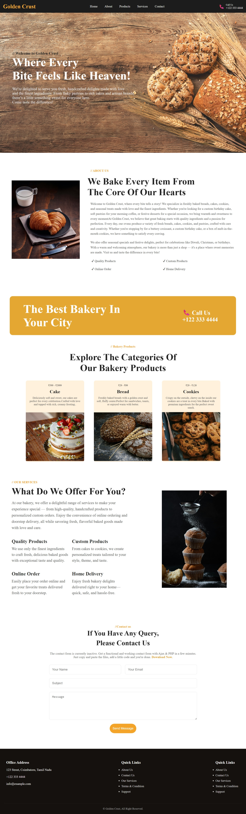
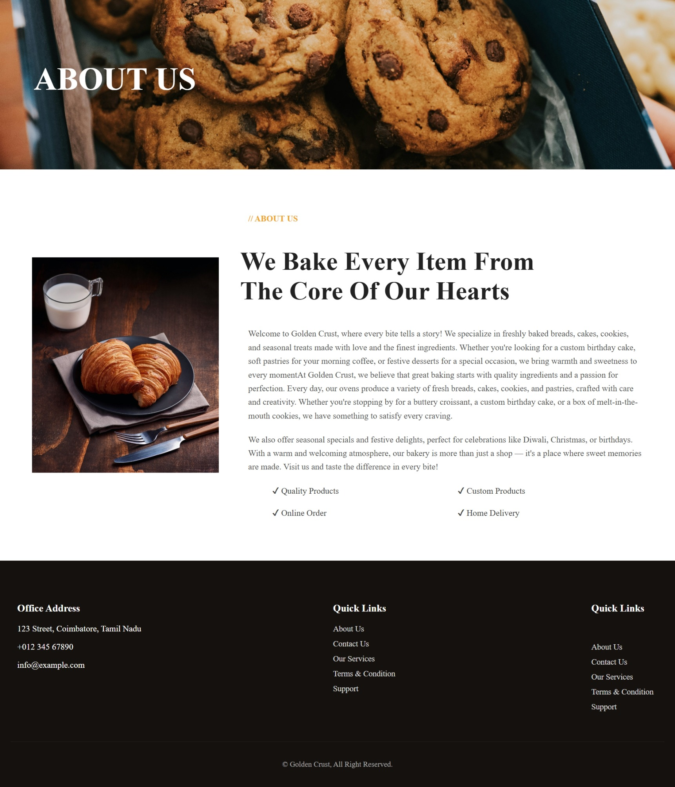
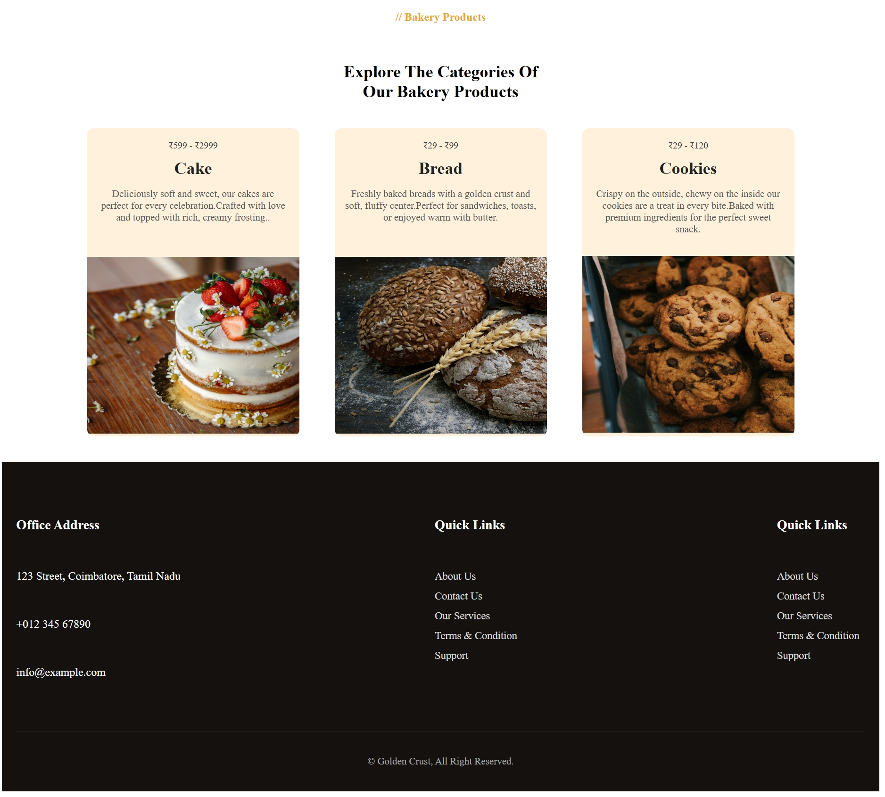
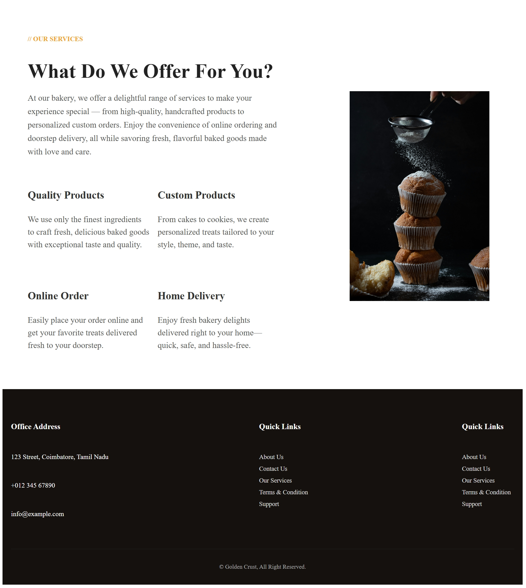
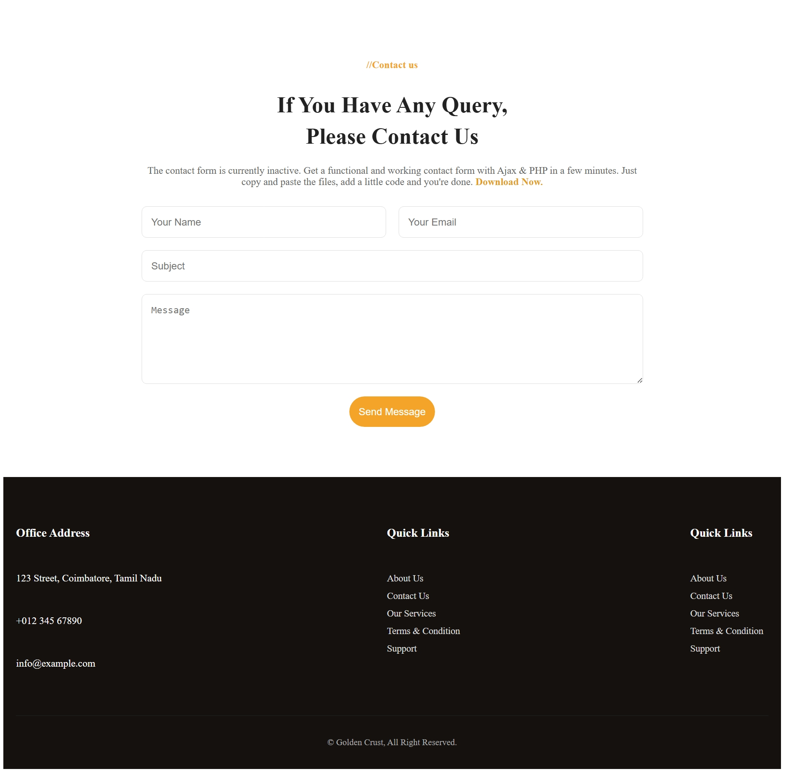

# 🥐 Golden Crust — Artisan Bakery Website

A responsive, multi-page bakery storefront website built with **HTML5**, **CSS3 (Flexbox & CSS Grid)**, and **Vanilla JavaScript**. Designed with a warm artisan aesthetic to showcase freshly baked cakes, breads, and cookies with interactive category filtering, a persistent client-side order basket, and a responsive mobile-first layout.

🔗 **Live Website:** [https://mohanariprasath.github.io/website/](https://mohanariprasath.github.io/website/)

---

## 🌐 Webpages Overview

| Webpage | File | Live Link | Description |
| :--- | :--- | :--- | :--- |
| **Home** | [`index.html`](./index.html) | [View Home](https://mohanariprasath.github.io/website/index.html) | Full landing page with hero banner, about preview, call-to-action banner, filterable product showcase, services overview, and contact section. |
| **About Us** | [`about.html`](./about.html) | [View About](https://mohanariprasath.github.io/website/about.html) | Bakery story, quality promise, daily fresh-baked highlights, and core values. |
| **Products** | [`products.html`](./products.html) | [View Products](https://mohanariprasath.github.io/website/products.html) | Interactive bakery menu featuring Cakes, Breads, and Cookies with category filtering and "Add to Order" basket controls. |
| **Services** | [`service.html`](./service.html) | [View Services](https://mohanariprasath.github.io/website/service.html) | Overview of bakery services including Quality Products, Custom Orders, Online Ordering, and Home Delivery. |
| **Contact Us** | [`contact.html`](./contact.html) | [View Contact](https://mohanariprasath.github.io/website/contact.html) | Customer inquiry and custom cake order form with validation and instant submission feedback. |

---

## ✨ Key Features

- **Responsive Multi-Page Layout:** Built with CSS Flexbox and CSS Grid for seamless desktop, tablet, and mobile viewing.
- **Interactive Order Basket (`localStorage`):** Add bakery items to the order basket, increment/decrement quantities, view live price totals, and place orders with toast notifications.
- **Dynamic Product Category Filtering:** Filter bakery items across *All Treats*, *Cakes*, *Breads*, and *Cookies* without page reloads.
- **Mobile Navigation Drawer:** Sticky navigation header with active link states and a responsive hamburger menu for mobile screens.
- **Interactive Contact Form:** Client-side form validation with instant user confirmation.

---

## 📸 Webpage Previews

### 1. Home Page (`index.html`)


### 2. About Us Page (`about.html`)


### 3. Products Page (`products.html`)


### 4. Services Page (`service.html`)


### 5. Contact Us Page (`contact.html`)


---

## 🛠️ Tech Stack

- **Markup:** HTML5 (Semantic elements)
- **Styling:** CSS3, CSS Custom Properties, Flexbox, CSS Grid, Media Queries ([`style.css`](./style.css))
- **Scripting:** Vanilla JavaScript (ES6+, DOM Manipulation, `localStorage` state) ([`script.js`](./script.js))
- **Typography & Icons:** Google Fonts (*Playfair Display* & *Poppins*), Font Awesome 6

---

## 📂 Project Structure

```text
website/
├── index.html          # Home page (Hero, About, Products, Services, Contact)
├── about.html          # About Us page
├── products.html       # Bakery Products menu page
├── service.html        # Our Services page
├── contact.html        # Contact Us form page
├── style.css           # Unified responsive stylesheet
├── script.js           # Interactive cart, category filter, mobile menu & form logic
├── screenshots/        # Full-page screenshots of all 5 webpages
│   ├── home.jpeg
│   ├── about.jpeg
│   ├── products.jpeg
│   ├── services.jpeg
│   └── contact.jpeg
└── README.md           # Project documentation
```

---

## 🚀 Getting Started Locally

1. **Clone the repository:**
   ```bash
   git clone https://github.com/Mohanariprasath/website.git
   cd website
   ```
2. **Open in browser:**
   Open `index.html` directly in any web browser or serve locally with VS Code Live Server.

---

## 👤 Author

**Mohanariprasath J**
- GitHub: [@Mohanariprasath](https://github.com/Mohanariprasath)
